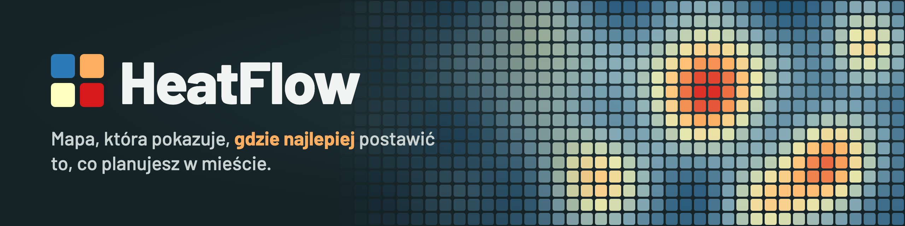
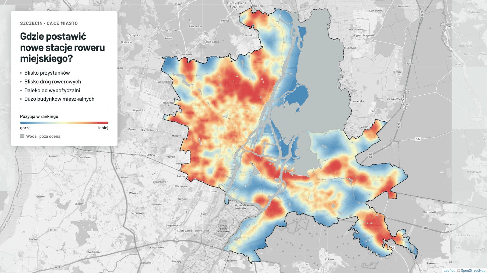
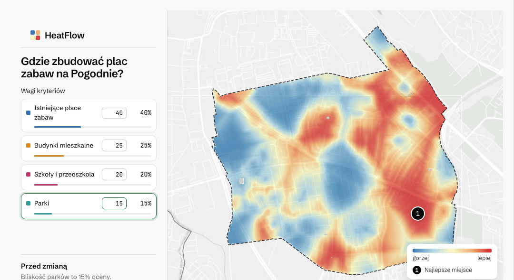
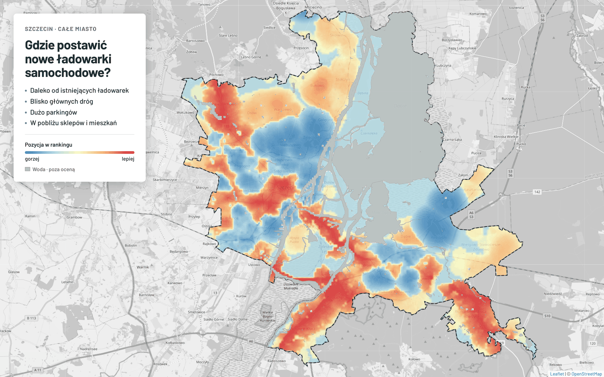
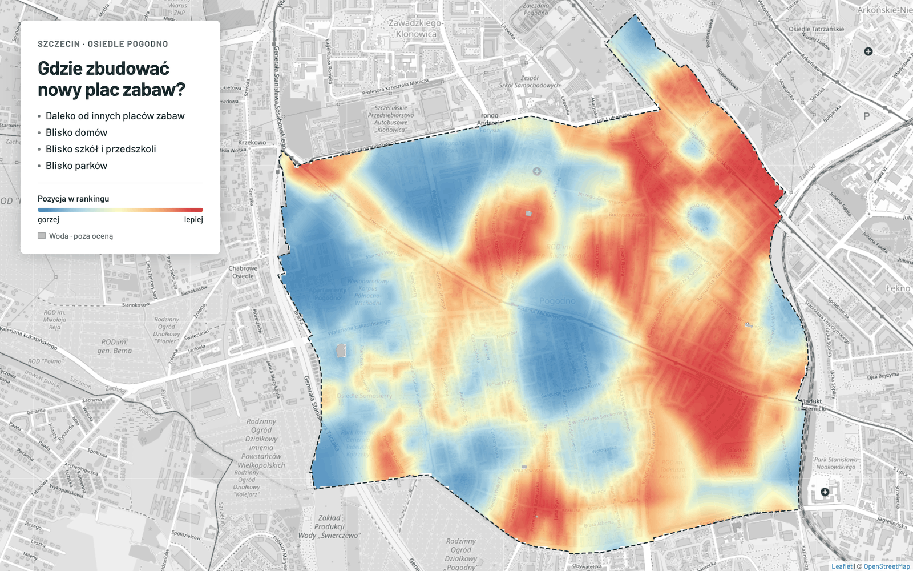
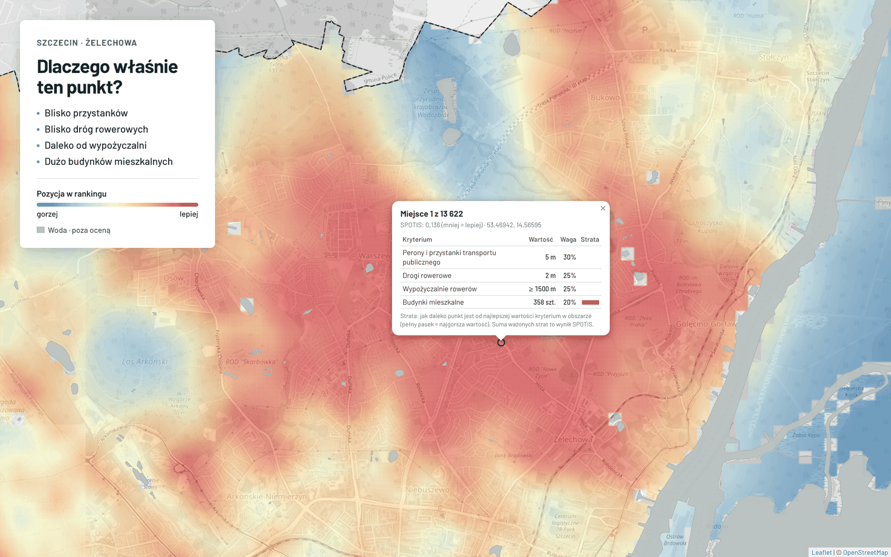

<p align="center">
  
</p>

<p align="center">
  <a href="LICENSE"></a>
  
  
  
  
</p>

<p align="center">
  
  &nbsp;
  
</p>

<p align="center">
  <b>Gdzie postawić stację roweru miejskiego? Gdzie nową ładowarkę? Gdzie zbudować plac zabaw?</b><br>
  HeatFlow odpowiada na takie pytania mapą: im cieplejszy kolor, tym lepsze miejsce.
</p>

<p align="center">
  
</p>

## Jak to działa

Wybierasz obszar i ustalasz, co jest ważne. HeatFlow ocenia miejsca na mapie i wskazuje 10 najlepszych lokalizacji.

**Plac zabaw na Pogodnie.** Zwiększamy wagę bliskości parków z 15% do 54%. HeatFlow od razu przelicza mapę i wskazuje nowe najlepsze miejsce.

<p align="center">
  
</p>

[Otwórz animację](assets/screenshots/zmiana-wagi.gif) · [Zobacz instrukcję krok po kroku](docs/instrukcja.md)

## Przykłady

<table>
  <tr>
    <td width="50%"></td>
    <td width="50%"></td>
  </tr>
  <tr>
    <td><b>Ładowarki samochodowe w całym mieście</b><br>Daleko od istniejących ładowarek, blisko głównych dróg i parkingów.</td>
    <td><b>Plac zabaw na jednym osiedlu</b><br>Można zbadać też mały fragment miasta, z dokładnością do ulicy.</td>
  </tr>
</table>

Każdy przykład to gotowy scenariusz z [`examples/`](examples/), który otwiera się jednym kliknięciem w aplikacji.

## Co jeszcze potrafi

- **Odległość pieszo**, liczona po chodnikach i ścieżkach, albo w linii prostej.
- **Wyjaśnienie wyniku**: po kliknięciu w mapę widać, które kryterium podniosło, a które obniżyło ocenę.
- **Pomijanie terenów** takich jak woda, lasy czy cmentarze.
- **Eksport** do GeoJSON, CSV i PNG oraz zapis całej analizy do pliku, żeby wrócić do niej później.
- **Działa lokalnie**: dane Szczecina z OpenStreetMap są na Twoim komputerze, analiza całego miasta trwa kilka–kilkanaście sekund.

<p align="center">
  
</p>

## Dokumentacja

- [Instrukcja obsługi krok po kroku](docs/instrukcja.md), ze zrzutami ekranu
- [Metodyka i szczegóły techniczne](docs/metodyka.md): jak liczone są odległości, wagi i oceny

## Autorzy


**Michał Gudowicz**, **Szymon Śniegowski**. Opieka naukowa: **dr hab. inż. Wojciech Sałabun**.
Koło naukowe **Data Engine**, Zachodniopomorski Uniwersytet Technologiczny w Szczecinie.

- Publikacja: Gudowicz M., Śniegowski S., Sałabun W., *An MCDA-based decision-making framework for
  evaluating virtual bike-sharing station locations with spatial data*, KES 2025.
- Wyróżnienie Komitetu Programowo-Organizacyjnego w Konkursie Młodych Mistrzów, Forum
  Teleinformatyki 2025.

## Wypróbuj u siebie

Potrzebny jest [uv](https://docs.astral.sh/uv/getting-started/installation/) (Python zainstaluje się sam).

```bash
git clone https://github.com/MichalGudowicz29/HeatFlow.git
cd HeatFlow
uv sync --extra importer
uv run heatflow import-region   # jednorazowo: dane Szczecina z OpenStreetMap (ok. 100 MB, ok. 1 min)
uv run heatflow serve --port 5050   # otwórz http://127.0.0.1:5050
```

Gotowe przykłady są w pierwszym kroku aplikacji (przyciski **Przykład: …**). Własne analizy zapisuje się i otwiera przyciskami **Zapisz** i **Wczytaj**.

<sub>Kod na licencji [MIT](LICENSE). Dane mapy © współtwórcy OpenStreetMap, licencja ODbL.</sub>
