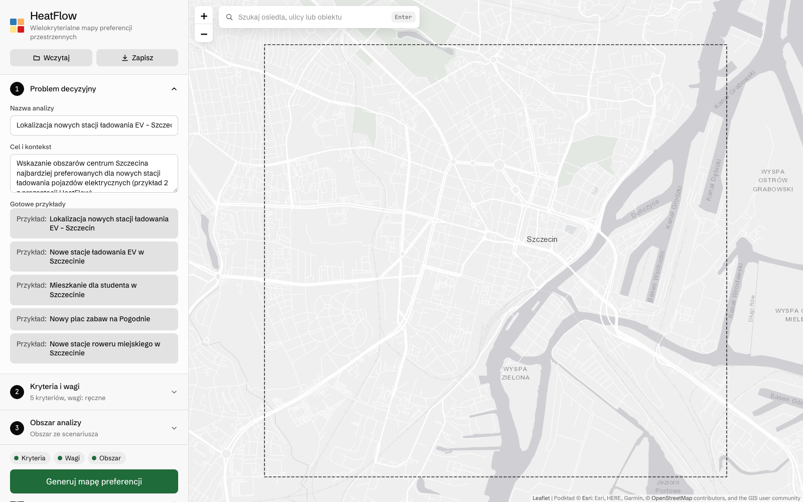
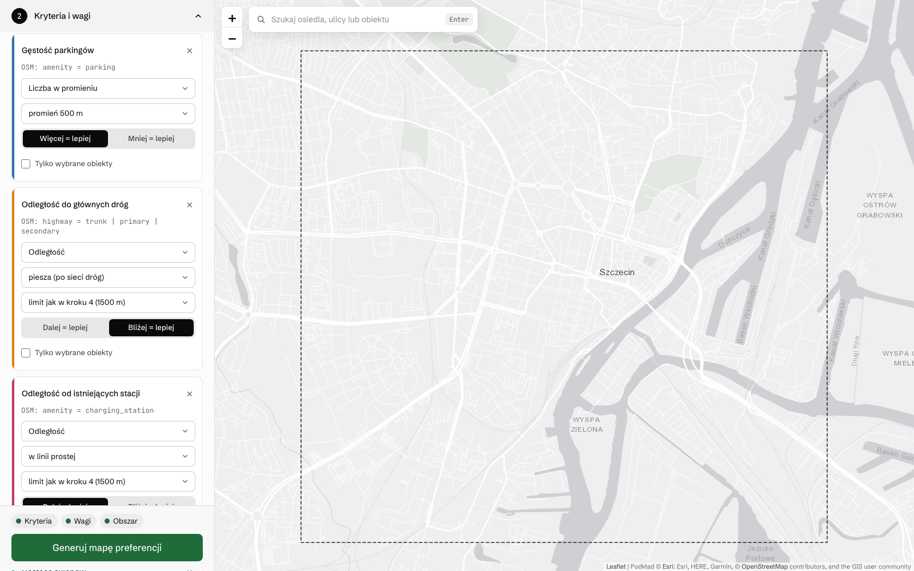
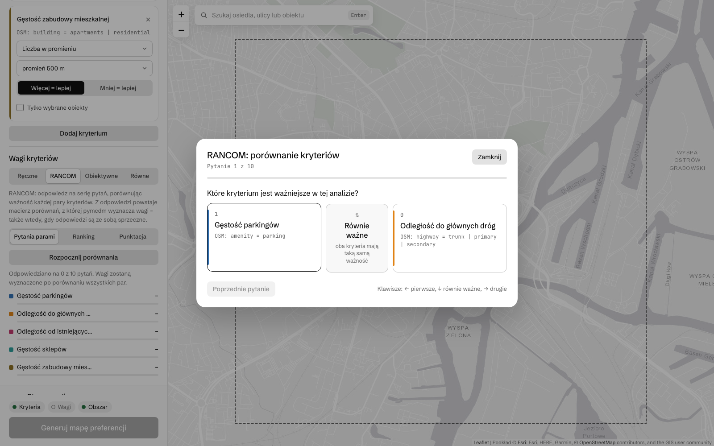
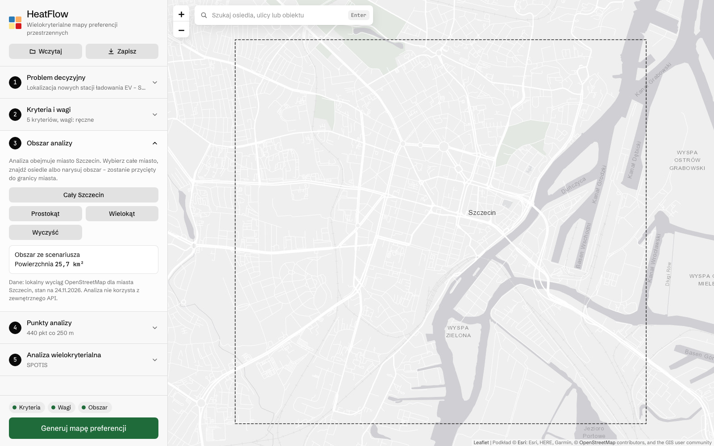
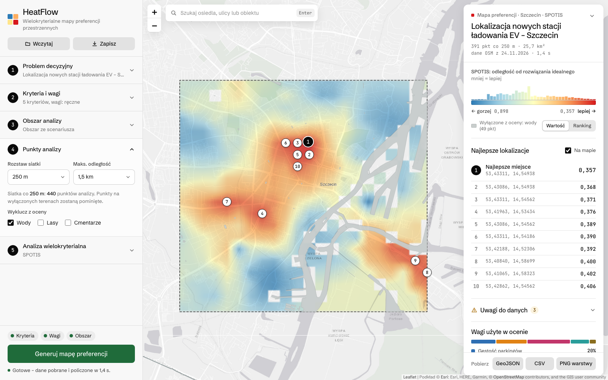
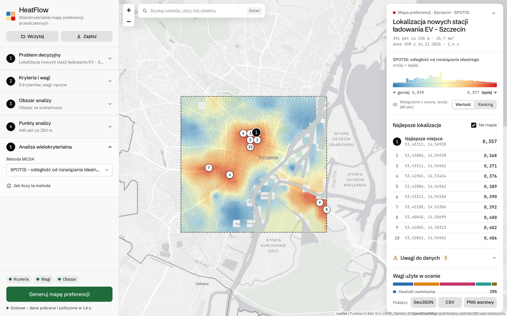
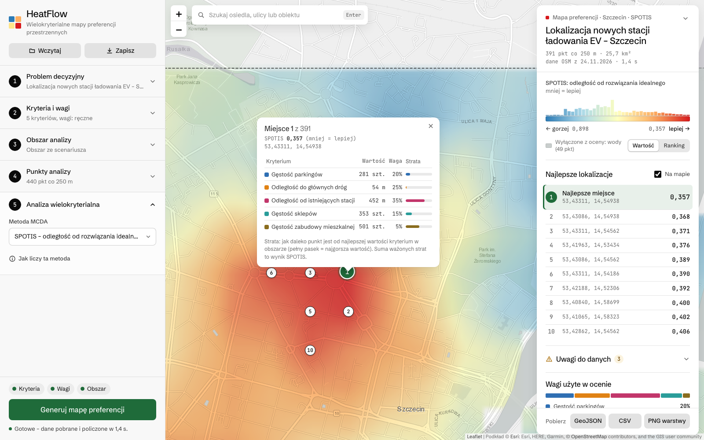
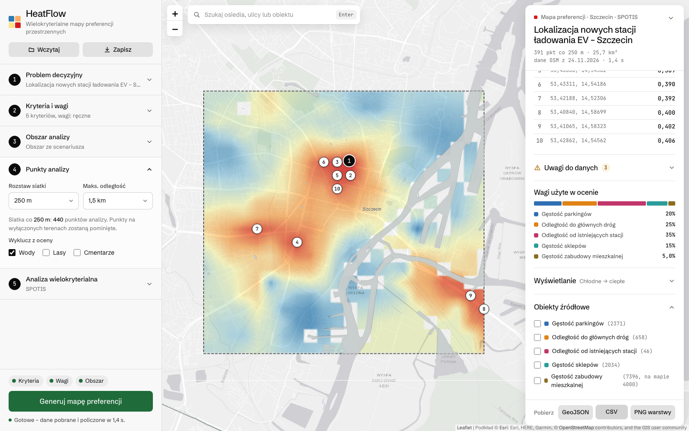

# Jak wybrać lokalizację w HeatFlow

## 1. Określ cel

Otwórz **Problem decyzyjny**. Wpisz nazwę analizy i pytanie, na które ma odpowiedzieć mapa. Jeśli chcesz przećwiczyć kolejne kroki na gotowych ustawieniach, kliknij przykład stacji ładowania. Przykład wypełni formularz i zaznaczy obszar w centrum Szczecina.

## 2. Wybierz kryteria i ustal, co jest ważniejsze

W sekcji **Kryteria i wagi** kliknij **Dodaj kryterium** i wybierz z katalogu obiekty, np. parkingi. Aby premiować miejsca z wieloma parkingami w okolicy, wybierz **Liczba w promieniu**, ustaw 500 m i zaznacz **Więcej = lepiej**. Jeśli zależy Ci na oddaleniu od istniejącej ładowarki, wybierz **Odległość** i **Dalej = lepiej**.

Przewiń panel do **Wagi kryteriów**. Wybierz **Równe**, jeśli każde kryterium ma mieć taki sam wpływ. Jeśli łatwiej Ci porównywać po dwie rzeczy, wybierz **RANCOM** i odpowiedz na wszystkie pytania. RANCOM przelicza Twoje porównania na wagi.

## 3. Zaznacz obszar

W sekcji **Obszar analizy** kliknij **Prostokąt** i przeciągnij po mapie od jednego narożnika do przeciwległego. Sprawdź obrys i powierzchnię po lewej stronie. Jeśli ćwiczysz na przykładzie, możesz zachować jego obszar.

## 4. Wybierz odstęp między punktami

Otwórz **Punkty analizy**. Wybierz rozstaw **Automatyczny** albo podaj odstęp z listy, np. 250 m. Program oceni miejsca rozmieszczone co tyle metrów. W polu **Wyklucz z oceny** zaznacz tereny, które chcesz pominąć. Na ilustracji po lewej widać ustawienia siatki użytej do gotowej mapy.

## 5. Wygeneruj mapę

Otwórz **Analiza wielokryterialna**. Na początek zostaw metodę **SPOTIS** i kliknij **Generuj mapę preferencji**. SPOTIS mierzy, ile każdemu miejscu brakuje do najlepszych wartości wybranych kryteriów w badanym obszarze. Im mniejszy wynik, tym lepiej.

## 6. Sprawdź wynik i zapisz go

Odczytaj kolory z legendy po prawej: im cieplej, tym lepiej. Słupki nad skalą pokazują, ile punktów uzyskało podobny wynik. Przełącznikiem **Wartość / Ranking** zmienisz skalę z wyniku metody na pozycję w rankingu. Kliknij kolorowy fragment mapy, aby sprawdzić wartości dla najbliższego punktu siatki. W kolumnie **Strata** pełny pasek oznacza najgorszą wartość danego kryterium w ocenianym obszarze.

Zaraz pod legendą jest lista **Najlepsze lokalizacje**. Kliknij wiersz, aby przybliżyć miejsce i otworzyć jego szczegóły. W pasku **Pobierz** na dole panelu wybierz **CSV**, aby pobrać tabelę, **GeoJSON**, aby otworzyć punkty w programie mapowym, lub **PNG warstwy**, aby zapisać samą kolorową warstwę. Przycisk **Zapisz** u góry po lewej pobiera ustawienia analizy. Możesz je później otworzyć przez **Wczytaj**.

## Najczęstsze pytania

**Dlaczego część mapy jest szara?** Szare wypełnienie wewnątrz obszaru oznacza tereny wyłączone z oceny, np. wodę. Przy legendzie znajdziesz liczbę pominiętych punktów.

**Czy czerwony zawsze oznacza dobre miejsce?** W domyślnej palecie tak. Po zmianie palety szukaj koloru podpisanego „lepiej” po prawej stronie legendy. Paletę i odwrócenie kolorów zmienisz w sekcji **Wyświetlanie** w panelu wyników.

**Jak sprawdzić inne wagi?** Wróć do kroku 2 i zmień wagi. Mapa przeliczy oceny na podstawie już pobranych danych. Po zmianie obszaru, zestawu kryteriów lub rozstawu siatki ponownie kliknij **Generuj mapę preferencji**.

**Co oznacza „≥ 1500 m” przy odległości?** To limit zastosowany w przykładzie. Odległości od tej granicy wzwyż są traktowane jednakowo. Przy dojściu pieszym taką wartość może też dostać punkt bez trasy w zasięgu limitu. Sprawdź sekcję **Uwagi do danych** w panelu wyników.
